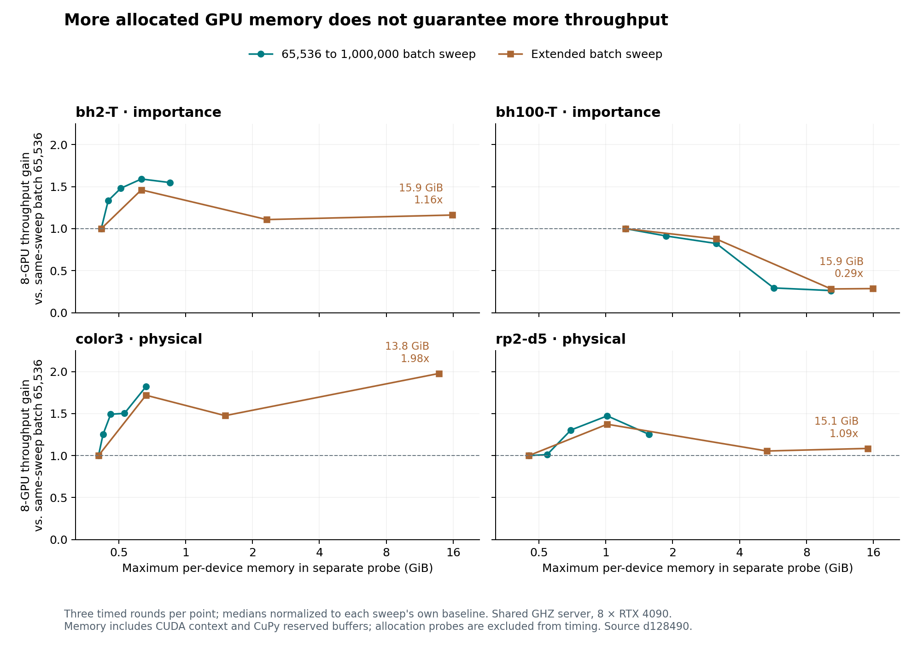

# Batch size, GPU memory and eight-device scaling, 2026-10-28

Increasing batch size improved eight-GPU throughput for three of four tested
workloads, but filling more VRAM was not consistently beneficial. Independent
five-round confirmation measured gains of **1.39x for bh2-T, 2.45x for color3
and 1.72x for rp2-d5** over each task's contemporaneous batch-65,536 baseline.
bh100-T showed no benefit from doubling its batch and became substantially
slower at very large batches. High-memory probes reached **13.80–15.92 GiB per
device**, so the experiment went well beyond the previous roughly 1 GiB usage.

The package implementation and CUDA kernels remain at
[`d128490e3c1ecef10379d5969a9d9b378af3bb07`](https://github.com/zhang-zk21t/magna/commit/d128490e3c1ecef10379d5969a9d9b378af3bb07),
based on upstream PR #5. Instrumentation and private overrides are confined to
the preserved benchmark scripts. No production API or default was changed, and
no upstream PR was created. This follows the
[eight-GPU and CPU comparison](eight-gpu-benchmark-20261028.md).

## Independent confirmation

Rates are million attempted draws per second, using five-round median wall
times. The baseline batch is 65,536 **per active GPU**. Memory is the maximum
per-device allocation-probe reading from the separate sweep, not memory
monitoring performed inside these timed calls.

| Task | Best confirmed eight-GPU batch among candidates | Device memory, GiB | Default eight-GPU rate | Selected eight-GPU rate | Throughput gain | Eight GPUs / best tested single GPU |
| --- | ---: | ---: | ---: | ---: | ---: | ---: |
| bh2-T | 524,288 | 0.63 | 682.78 | 952.30 | 1.39x | 4.81x |
| bh100-T | 65,536, unchanged | 1.23 | 36.82 | 36.82 | 1.00x | 4.78x |
| color3 | 50,331,648, experimental override | 13.80 | 538.50 | 1,317.66 | 2.45x | 6.20x |
| rp2-d5 | 524,288 | 1.02 | 155.57 | 267.08 | 1.72x | 5.69x |

The last column allows the single-GPU baseline its own best tested batch:
524,288 for bh2-T and rp2-d5, 131,072 for bh100-T, and 1,000,000 for color3.
These are best observed candidates, not claims of globally optimal parameters.
The single-GPU case uses one active worker in the same process-pool path as
eight GPUs, including dispatch and aggregation; it is not the earlier direct
parent-process `CudaSampler` baseline.

All confirmation candidates are shown below to distinguish absolute throughput
from scaling at the same batch size:

| Task | Batch | Single-GPU million/s | Eight-GPU million/s | Eight / one, same batch |
| --- | ---: | ---: | ---: | ---: |
| bh2-T | 65,536 | 159.59 | 682.78 | 4.28x |
| bh2-T | 524,288 | 198.13 | 952.30 | 4.81x |
| bh100-T | 65,536 | 6.91 | 36.82 | 5.33x |
| bh100-T | 131,072 | 7.71 | 36.52 | 4.74x |
| color3 | 65,536 | 109.75 | 538.50 | 4.91x |
| color3 | 1,000,000 | 212.63 | 1,113.71 | 5.24x |
| color3 | 50,331,648 | 173.74 | 1,317.66 | 7.58x |
| rp2-d5 | 65,536 | 42.73 | 155.57 | 3.64x |
| rp2-d5 | 524,288 | 46.94 | 267.08 | 5.69x |

For color3, the 7.58x same-batch ratio compares against a single GPU slowed by
the very large batch. The fairer comparison against the faster single-GPU
1,000,000 batch is **6.20x**. Within the existing public API limit, color3 already
gets **2.07x** the default eight-GPU throughput at batch 1,000,000 and about
0.66 GiB/device. The experimental large batch adds a further **18.3%** throughput
while using about 20.8 times that probe memory. Raising the batch limit is thus
a workload-dependent tradeoff, not a prerequisite for most of the measured gain.

The shared host had a one-minute load of 165.96–184.49 during confirmation,
with 128 logical CPUs. The following ranges show actual wall times in seconds;
they are not confidence intervals. Small differences such as bh100-T's 0.8%
eight-GPU change are inconclusive at this level of variation.

| Task / batch | Single-GPU median [min, max] | Eight-GPU median [min, max] |
| --- | ---: | ---: |
| bh2-T / 65,536 | 3.364 [3.306, 4.238] | 0.786 [0.750, 0.969] |
| bh2-T / 524,288 | 2.710 [2.504, 3.026] | 0.564 [0.547, 0.719] |
| bh100-T / 65,536 | 7.737 [7.488, 8.478] | 1.452 [1.276, 1.665] |
| bh100-T / 131,072 | 6.938 [6.702, 8.542] | 1.464 [1.354, 1.604] |
| color3 / 65,536 | 4.892 [2.652, 5.529] | 0.997 [0.725, 1.042] |
| color3 / 1,000,000 | 2.525 [1.886, 2.879] | 0.482 [0.411, 0.526] |
| color3 / 50,331,648 | 3.090 [3.063, 3.120] | 0.407 [0.399, 0.445] |
| rp2-d5 / 65,536 | 7.559 [7.409, 11.192] | 2.076 [1.788, 2.388] |
| rp2-d5 / 524,288 | 6.880 [5.756, 8.571] | 1.209 [1.037, 1.292] |

## Throughput relative to the serial CPU API

The following is a **derived throughput ratio**, combining the confirmed
eight-GPU rates above with the previously measured single-process,
single-threaded `magna.run` CPU rates. It is not a newly measured equal-shot
end-to-end speedup, nor a comparison against all cores in one CPU socket.
Both datasets use implementation `d128490`, the same circuits, task options
and physical/importance sampling configurations.

The calculation is `(GPU draws / GPU median wall time) / (CPU draws / CPU
median wall time)`. CPU rates come from five 262,144-draw runs per task in the
[CPU raw results](benchmark-results/cpu-eight-gpu-20261028-results.json), measured
at 12:31–12:41 Asia/Shanghai. GPU rates come from the confirmation above at
14:18–14:24, using 53,477,376–536,870,912 draws per run. Both exclude initial
compilation and worker startup. The sessions have different shared-host loads;
these ratios describe observed rates, not guaranteed speedups for an equal-sized
job or a dedicated machine. No new CPU measurements were taken for this table.

| Task | Serial CPU draws/s | Selected eight-GPU million draws/s | Eight-GPU / CPU throughput ratio |
| --- | ---: | ---: | ---: |
| bh2-T | 31,467 | 952.30 | approximately 30,264x |
| bh100-T | 2,981 | 36.82 | approximately 12,353x |
| color3 | 35,701 | 1,317.66 | approximately 36,908x |
| rp2-d5 | 29,144 | 267.08 | approximately 9,164x |

The color3 row uses the experimental batch 50,331,648. At the public API's
1,000,000 batch, its corresponding ratio is approximately **31,195x** instead.
The other selected batches are within the existing public limit.

The earlier **equal-work** CPU/eight-GPU experiment used 262,144 draws in both
modes and measured 1,219x, 3,252x, 1,146x and 836x respectively. Those results
remain valid for that smaller workload. The larger rate ratios above also
reflect amortizing dispatch and launch costs over far more GPU draws, so they
must not be described as improvements due to batch tuning alone.

## Memory sweep

The first sweep tested batches 65,536, 131,072, 262,144, 524,288 and 1,000,000,
with three timed repetitions per task. The extended sweep then compared large
batches against its own repeated baseline. All rates here are from the extended
sweep, so differences between sessions are not mistaken for batch-size gains.

| Task | Extended-sweep batch 65,536 rate, million/s | Highest-memory batch | Device peak, GiB | Live CuPy peak, GiB | Reserved CuPy peak, GiB | High-memory rate, million/s | Gain vs. same-sweep baseline |
| --- | ---: | ---: | ---: | ---: | ---: | ---: | ---: |
| bh2-T | 607.20 | 33,554,432 | 15.85 | 11.69 | 15.47 | 705.67 | 1.16x |
| bh100-T | 34.96 | 1,572,864 | 15.92 | 10.52 | 15.33 | 10.02 | 0.29x |
| color3 | 671.69 | 50,331,648 | 13.80 | 10.64 | 13.41 | 1,328.41 | 1.98x |
| rp2-d5 | 217.33 | 12,582,912 | 15.12 | 10.61 | 14.73 | 235.90 | 1.09x |



For bh2-T, the extended sweep's batch 524,288 achieved 887.64 million/s with
0.63 GiB/device, outperforming the 15.85 GiB setting. For rp2-d5, batch 524,288
achieved 298.49 million/s with 1.02 GiB/device, also outperforming its largest
setting. bh100-T became approximately 3.5 times slower at the largest batch.
Only color3 kept a meaningful gain at the largest tested allocation.

The current sampler materializes Pauli frames, query features, exact-query
outputs and reduction buffers. Query feature counts differ markedly:
117/121 for bh2-T, 2,982/3,282 for bh100-T, 56/59 for color3 and 347/350 for
rp2-d5. Thus a common batch size does not imply a common memory footprint.
Larger batches reduce the number of launches, host transfers and per-batch
merges, while increasing the intermediate arrays and work in the final
single-block statistics reduction. These are mechanisms visible in the code;
this experiment does not isolate cache, memory-bandwidth, scheduling or reduction
bottlenecks with a kernel profiler. VRAM occupancy alone is not a useful tuning
objective. A per-workload throughput search with a memory budget is better
supported by these measurements than a universal large batch.

## Measurement and implementation details

The hardware and software match the earlier report: ghz, physical GPUs 1–8,
eight RTX 4090 24 GB cards, two Xeon Platinum 8358P CPUs, Python 3.13.5,
NumPy 2.1.3, CuPy 14.2.0, driver 560.35.03, local CUDA/NVRTC 12.6,
and GCC 11.4.0 `-O3 -DNDEBUG`. GPU 0's existing context was untouched.

All comparisons use fixed total draws per task: 536,870,912 for bh2-T and
color3, 53,477,376 for bh100-T, and 322,961,408 for rp2-d5. Methods and proposal
scales are unchanged: importance at 1000/7 and 500/77 for bh2-T and bh100-T,
and physical sampling for color3 and rp2-d5. Increasing a batch does not increase
the measured sample count. Time surrounds the full `MultiGpuCudaSampler.run`
call. First-use compilation, startup, allocation warmup and probes are excluded.

The three-round sweeps rotate batch order and use seeds 20261028–20261030.
Confirmation uses new seeds 20261128–20261132 and rotates the full list of
device-count/batch combinations over five rounds. It retains one eight-worker
pool, privately selecting one active device or all eight only between completed
calls. Other workers remain idle. This avoids allocating two large pools on
the same GPU. Two full batches per active worker warm the allocation shape
before every timed confirmation call. No rounds were discarded.

The public/native limit remains **1,000,000 draws per batch**. Larger values
are explicitly experimental: the scripts override only the Python sampler's
copied `max_shots` metadata, in the parent validator and spawned worker. They
do not raise the C++ native bridge limit or send oversized arrays through CPU
reference bridges. Device kernels use 64-bit shot and array indices; the
harness checks a conservative grid-size bound for actual feature counts and
caps the CuPy allocation pool at **18 GiB per device**, leaving space for CUDA
allocations outside the pool. This validates the tested shapes, not general
public support for arbitrary larger batches. Calling the unchanged public API
with batch 50,331,648 still raises its batch-limit error.

Memory measurements are separate two-full-batch probes per worker. After
initial warmup, free cached blocks are released. A temporary CuPy allocator
wrapper records live and reserved pool high-water marks and queries device
free memory after each allocation; it also samples device memory at completion.
The device peak includes context and reserved buffers. It is an allocation-point
probe maximum, not continuous instrumentation of every timed run. Cached unused
blocks explain why device/reserved memory exceeds the live-array peak. The
allocator wrapper is removed before all timing; later timed calls can retain
buffers from multiple batch sizes, still subject to the pool cap.

Measured windows on 2026-10-28:

- Supported-range sweep: 06:08:18–06:10:56 UTC (14:08:18–14:10:56 Asia/Shanghai).
- Extended sweeps: 06:12:37–06:15:09 UTC (14:12:37–14:15:09 Asia/Shanghai).
- Confirmation: 06:18:45–06:24:33 UTC (14:18:45–14:24:33 Asia/Shanghai).

Load samples across all phases ranged from 165.96 to 192.61. These are exploratory
shared-host measurements, not dedicated-machine peaks. Comparisons in the main
table use the same confirmation session rather than older throughput numbers.

All **108 sweep calls and 90 confirmation calls** completed. Estimates and
standard errors were compared across batches and, in confirmation, device counts
at the same seed and draw interval with `rtol=1e-8, atol=1e-15`. The maximum
absolute difference was 4.441e-16 in sweeps and 2.776e-15 in confirmation.
All recorded shard counts, completed draws, summary medians and driver hashes
were checked. No allocation failures occurred. After completion, GPUs 1–8
returned to 2 MiB and 0% utilization, with only the original GPU 0 process left.

## Evidence and reproduction

- [Sweep driver](benchmark-results/run-batch-memory-20261028.py),
  [confirmation driver](benchmark-results/confirm-batch-memory-20261028.py), and
  [plot script](benchmark-results/plot-batch-memory-20261028.py).
- [Supported-range raw data](benchmark-results/batch-supported-20261028-results.json)
  and [log](benchmark-results/batch-supported-20261028.log).
- Extended raw data for [bh2-T](benchmark-results/batch-high-bh2-T-20261028.json),
  [bh100-T](benchmark-results/batch-high-bh100-T-20261028.json),
  [color3](benchmark-results/batch-high-color3-20261028.json),
  [rp2-d5](benchmark-results/batch-high-rp2-d5-20261028.json), and the
  [combined log](benchmark-results/batch-high-20261028.log).
- [Confirmation raw data](benchmark-results/batch-confirm-20261028-results.json)
  and [log](benchmark-results/batch-confirm-20261028.log).

Use the environment and eight-device UUID selection from the preceding report,
with `PYTHONPATH=core:.` and OpenBLAS/OMP/MKL thread limits set to one. From the
repository root, the following commands reproduce the three stages. The
confirmation script imports the sweep driver, which imports the preserved
eight-GPU benchmark helper; keep these files together.

```sh
scripts=docs/development/benchmark-results
reference=$scripts/four-gpu-20261028-results.json
revision=d128490e3c1ecef10379d5969a9d9b378af3bb07
.venv/bin/python "$scripts/run-batch-memory-20261028.py" \
    --source-commit "$revision" --reference-results "$reference" \
    --output batch-supported-results.json
.venv/bin/python "$scripts/run-batch-memory-20261028.py" \
    --source-commit "$revision" --reference-results "$reference" --tasks bh2-T \
    --batches 65536 524288 4194304 33554432 --experimental-limit 33554432 \
    --output batch-high-bh2-T.json
.venv/bin/python "$scripts/run-batch-memory-20261028.py" \
    --source-commit "$revision" --reference-results "$reference" --tasks bh100-T \
    --batches 65536 262144 1000000 1572864 --experimental-limit 1572864 \
    --output batch-high-bh100-T.json
.venv/bin/python "$scripts/run-batch-memory-20261028.py" \
    --source-commit "$revision" --reference-results "$reference" --tasks color3 \
    --batches 65536 1000000 4194304 50331648 --experimental-limit 50331648 \
    --output batch-high-color3.json
.venv/bin/python "$scripts/run-batch-memory-20261028.py" \
    --source-commit "$revision" --reference-results "$reference" --tasks rp2-d5 \
    --batches 65536 524288 4194304 12582912 --experimental-limit 12582912 \
    --output batch-high-rp2-d5.json
.venv/bin/python "$scripts/confirm-batch-memory-20261028.py" \
    --source-commit "$revision" --reference-results "$reference" \
    --output batch-confirm-results.json
```

Sweep commands require a fresh output name because the accompanying `.memory`
directory must not already exist. Preserve the raw data and use another output
name when repeating an experiment.
