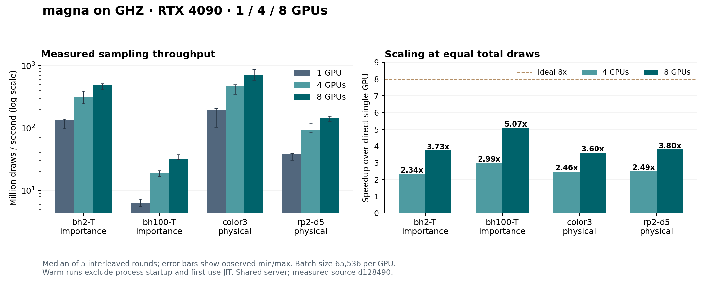

# Eight-GPU sampling on ghz, 2026-10-28

Eight RTX 4090 GPUs achieved **3.60x to 5.07x** the direct single-GPU throughput
and **1.46x to 1.70x** the four-GPU throughput in an interleaved experiment.
The single- and four-GPU baselines below were measured again in the same session.
They are not copied from the [earlier four-GPU report](four-gpu-benchmark-20261028.md).
The 91 CUDA correctness tests also passed with all eight devices selected.
A separate equal-work comparison against the existing single-threaded CPU API
measured **836x to 3,252x** eight-GPU speedups, with substantial short-call jitter.

The measured implementation remains
[`d128490e3c1ecef10379d5969a9d9b378af3bb07`](https://github.com/zhang-zk21t/magna/commit/d128490e3c1ecef10379d5969a9d9b378af3bb07),
based on the final head of [upstream PR #5](https://github.com/itpyi/magna/pull/5).
No implementation or CUDA kernel changes were needed for eight devices.
This work is confined to the fork branch `experiment/multi-gpu-sampling`;
no upstream pull request was created.

The later [batch-size and memory experiment](batch-memory-benchmark-20261028.md)
tests larger batches, allocation peaks and new interleaved single/eight-device
baselines. The measurements below remain the original batch-65,536 session.

## GPU throughput

Rates count attempted Monte Carlo draws, including rejected draws. Each row
uses the same draw count in all three modes, five rounds, batch size 65,536
per device and persistent workers. Rates are draws divided by median wall time;
speedups are ratios of median wall times.

| Example | Draws per run | Single GPU, million/s | Four GPUs, million/s | Eight GPUs, million/s | 8 / 1 speedup | 8 / 4 speedup |
| --- | ---: | ---: | ---: | ---: | ---: | ---: |
| bh2-T | 134,217,728 | 133.44 | 312.03 | 497.77 | 3.73x | 1.60x |
| bh100-T | 13,369,344 | 6.32 | 18.89 | 32.07 | 5.07x | 1.70x |
| color3 | 134,217,728 | 194.23 | 478.73 | 699.02 | 3.60x | 1.46x |
| rp2-d5 | 80,740,352 | 37.87 | 94.43 | 143.74 | 3.80x | 1.52x |



Eight-device parallel efficiency relative to ideal 8x scaling was 45.0%–63.4%.
Doubling from four to eight cards improved throughput for every tested task,
but did not double it. These timings do not isolate the causes of the gap.

Wall times in seconds, shown as median [observed minimum, maximum]:

| Example | Single GPU | Four GPUs | Eight GPUs |
| --- | ---: | ---: | ---: |
| bh2-T | 1.0058 [0.9675, 1.3710] | 0.4301 [0.3449, 0.5516] | 0.2696 [0.2609, 0.3260] |
| bh100-T | 2.1140 [1.8398, 2.3920] | 0.7076 [0.6436, 0.7922] | 0.4169 [0.3591, 0.4210] |
| color3 | 0.6910 [0.6493, 1.2967] | 0.2804 [0.2689, 0.3830] | 0.1920 [0.1525, 0.2276] |
| rp2-d5 | 2.1321 [2.0476, 2.6057] | 0.8550 [0.6913, 0.9553] | 0.5617 [0.5156, 0.6248] |

The shared host's one-minute CPU load during rounds was 149.20–155.42 with
128 logical CPUs available. The ranges describe observations, not confidence
intervals or dedicated-server peak performance. Differences from the preceding
four-GPU run are a reason to use these contemporaneous baselines for scaling.

## Method and correctness

The GPU experiment ran from 04:29:06 to 04:31:16 UTC on 2026-10-28
(12:29:06–12:31:16 Asia/Shanghai). The hardware and software environment is the
same as the earlier report: two Xeon Platinum 8358P CPUs, RTX 4090 24 GB cards,
driver 560.35.03, local CUDA/NVRTC 12.6, CuPy 14.2.0 linked against CUDA 12.9,
Python 3.13.5, NumPy 2.1.3, and GCC 11.4.0 with `-O3 -DNDEBUG`.

Physical GPUs **1–8** were idle at preflight and selected by UUID. GPU 0's
existing compute context was preserved. The direct baseline used physical
GPU 1, the four-device pool used physical GPUs 1–4, and the eight-device pool
used physical GPUs 1–8. The selected UUIDs and full inventories are in the
raw JSON. Foreign compute processes were checked before and after each run.
These checks do not constitute a scheduler reservation.

Sampling methods match the earlier experiment: bh2-T uses importance sampling
with scale 1000/7, bh100-T uses importance sampling with scale 500/77, and color3
and rp2-d5 use physical sampling. Draw counts come from the earlier result file;
no adaptive pilot selected new counts in this experiment. Seeds 20261028–20261032
and identical global draw intervals are used across GPU counts within each round.
Mode order rotates across rounds and tasks; all raw orders are recorded.

Separate four- and eight-worker pools remain initialized for each task, alongside
the direct sampler's parent context. Only one mode performs sampling at a time.
Each mode first runs 524,288 draws, then an unmeasured 1,048,576-draw warmup.
Timing surrounds the full public `run` call, including synchronization,
communication and aggregation. Circuit compilation, process startup and
first-use JIT are excluded from the main table. All rounds are retained.

Eight-worker first calls, including their 524,288 draws, took 3.407, 5.123,
3.568 and 3.045 seconds for the four tasks respectively. The CuPy disk cache
was already populated; these are not clean-cache cold-start measurements.

The [eight-device test log](benchmark-results/eight-gpu-20261028-cuda-tests.log)
records `Ran 91 tests in 32.674s`, `OK`, with no unittest skips. It includes
physical and importance sampling across eight real devices, CPU-reference
comparison, reuse and offsets crossing 2^32. As in the prior report, the
trailing `Skipped: occupied` message is output from a mocked guard unit test.

All 20 three-mode benchmark rounds completed. Each four- and eight-device result
was checked against the direct result for every estimate and standard error
with `rtol=1e-8, atol=1e-15`. Across these 40 comparisons, the largest absolute
difference was **9.992e-16**. This is numerical agreement for the tested cases,
not a claim of bitwise equality.

## CPU comparison at equal work

Each mode attempts 262,144 draws per run. The table uses medians of five rounds;
the GPU times here are milliseconds, while CPU times are seconds.

| Example | CPU wall time, s | Eight-GPU wall time, ms | CPU draws/s | Eight-GPU million draws/s | Eight GPUs / CPU speedup |
| --- | ---: | ---: | ---: | ---: | ---: |
| bh2-T | 8.3308 | 6.8336 | 31,467 | 38.36 | 1,219x |
| bh100-T | 87.9422 | 27.0423 | 2,981 | 9.69 | 3,252x |
| color3 | 7.3428 | 6.4060 | 35,701 | 40.92 | 1,146x |
| rp2-d5 | 8.9948 | 10.7587 | 29,144 | 24.37 | 836x |

Observed ranges, with no discarded rounds:

| Example | CPU min–max, s | Eight-GPU min–max, ms | Individual paired speedup min–max |
| --- | ---: | ---: | ---: |
| bh2-T | 7.7259–10.6966 | 2.1863–54.6963 | 141x–3,810x |
| bh100-T | 82.7449–90.0009 | 12.7758–73.5795 | 1,223x–6,884x |
| color3 | 4.6983–8.1170 | 4.0854–20.3176 | 398x–1,902x |
| rp2-d5 | 7.9574–9.6084 | 4.2617–33.0101 | 260x–2,111x |

These short GPU calls have large relative timing variation. Treat the median
ratios as observed performance under this shared-host workload, not precise
hardware constants or clean-machine peak speedups. The equal-work comparison
ran from 04:31:32 to 04:41:42 UTC (12:31:32–12:41:42 Asia/Shanghai), with
one-minute load samples between 139.34 and 155.06.

The CPU baseline is the existing public `magna.run(compiled, shots=..., seed=...)`
API, using the native CPU implementation in one process and one thread. It is
not a benchmark of all 128 logical CPUs running in parallel. No CPU affinity
was pinned; OpenBLAS, OMP and MKL thread limits were one. The raw records include
the observed parent thread count, CPU process time and wall time.
Every measured CPU call had one observed parent thread and zero reported
compilations. Median CPU process times were 7.867, 73.387, 6.486 and 8.126 seconds
respectively; the primary comparison uses wall time in both modes.

This separate experiment uses **262,144 draws in each mode**, five alternating
CPU/eight-GPU pairs per task, the same task options and proposal scales as the
GPU scaling experiment, and GPU batch size 65,536. Both modes reuse compiled
tasks. CPU warmup uses 4,096 draws; the eight-worker pool is started and warmed
with 262,144 draws before measurement. Timers surround the full public API call,
excluding initial compilation and worker startup. CPU `run` retains its normal
internal batching. The eight-card pool is idle during each CPU measurement.

Each GPU receives just 32,768 draws in this comparison, so it performs a single
partial batch. These short calls expose launch, process-dispatch and host
scheduling latency. Their throughput should not be substituted for the large
GPU-only workloads above, which contain many batches per card. All five pairs
are retained, including slow outliers, and the primary speedup uses medians.

The CPU API uses Python's `Random` stream, while the GPU sampler addresses
Philox draws. Equal numeric seeds therefore do not produce equal samples.
The driver records absolute estimate differences divided by the quadrature sum
of the two reported standard errors. These are statistical diagnostics, distinct
from the strict same-Philox numerical comparisons between GPU counts.
All 20 pairs completed their requested draws. Across all 60 estimate comparisons,
the largest standardized difference was **2.0383**, with no evident statistical
disagreement in these runs. This diagnostic is not proof of equivalence for all
tasks or a substitute for the real-device correctness tests.

After both experiments, an independent process query found only the original
GPU 0 context. Physical GPUs 1–8 had each returned to 2 MiB and 0% utilization.

## Raw evidence and reproduction

- [GPU raw results](benchmark-results/eight-gpu-20261028-results.json)
- [GPU console log](benchmark-results/eight-gpu-20261028-benchmark.log)
- [GPU benchmark driver](benchmark-results/run-eight-gpu-20261028.py)
- [Plot script](benchmark-results/plot-eight-gpu-20261028.py)
- [CPU/eight-GPU benchmark driver](benchmark-results/run-cpu-eight-gpu-20261028.py)
- [CPU/eight-GPU raw results](benchmark-results/cpu-eight-gpu-20261028-results.json)
- [CPU/eight-GPU console log](benchmark-results/cpu-eight-gpu-20261028-benchmark.log)

Use the measured implementation commit and preserved benchmark scripts, with
NumPy and CuPy installed and the native extension built. Set `CUDA_VISIBLE_DEVICES`
to the eight idle, allocated UUIDs in `selected_gpu_uuids` from the raw JSON.
From the repository root:

```sh
export CUDA_PATH=/usr/local/cuda-12.6
export LD_LIBRARY_PATH=/usr/local/cuda-12.6/lib64${LD_LIBRARY_PATH:+:$LD_LIBRARY_PATH}
export CUPY_CACHE_DIR=/tmp/magna-multigpu-20261028-d128490/cupy-cache
export OPENBLAS_NUM_THREADS=1 OMP_NUM_THREADS=1 MKL_NUM_THREADS=1 PYTHONPATH=core:.
MAGNA_TEST_CUDA_DEVICES=0,1,2,3,4,5,6,7 .venv/bin/python -m unittest discover \
    -s tests/core -p 'test_cuda*.py' -v
.venv/bin/python docs/development/benchmark-results/run-eight-gpu-20261028.py \
    --source-commit d128490e3c1ecef10379d5969a9d9b378af3bb07 \
    --reference-results docs/development/benchmark-results/four-gpu-20261028-results.json \
    --repeat 5 --batch-size 65536 --output eight-gpu-results.json
.venv/bin/python docs/development/benchmark-results/run-cpu-eight-gpu-20261028.py \
    --source-commit d128490e3c1ecef10379d5969a9d9b378af3bb07 \
    --reference-results docs/development/benchmark-results/four-gpu-20261028-results.json \
    --repeat 5 --shots 262144 --output cpu-eight-gpu-results.json
```
