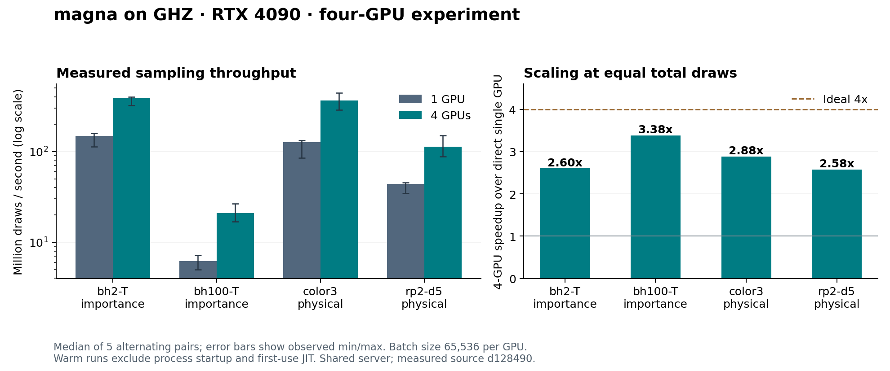

# Four-GPU sampling on ghz, 2026-10-28

Four RTX 4090 GPUs delivered **2.58x to 3.38x** the warmed sampling throughput
of the direct single-GPU sampler across four example workloads. All 91 CUDA
tests passed, and all 20 paired benchmark runs agreed on estimates and standard
errors within the specified numerical tolerance. These are measurements on a
shared server, with substantial variation between repetitions.

This experiment remains on the fork branch `experiment/multi-gpu-sampling`;
no upstream pull request was created. The measured implementation is
[`d128490e3c1ecef10379d5969a9d9b378af3bb07`](https://github.com/zhang-zk21t/magna/commit/d128490e3c1ecef10379d5969a9d9b378af3bb07),
based on the final head of [upstream PR #5](https://github.com/itpyi/magna/pull/5),
`5a0e201b420c09625f77c59889bbc60b6ed8a478`. The CUDA kernels are unchanged.
The evidence and report were added after the measured implementation commit.

## Results

Throughput counts attempted Monte Carlo draws, including rejected draws; it is
not a rate of accepted samples. Each row uses the same total draws for single
and four GPUs. Speedup is the ratio of the two median wall times, not the best
individual pair or an extrapolation.

| Example | Sampling | Draws per run | Single GPU, million draws/s | Four GPUs, million draws/s | Speedup | Efficiency vs. 4x |
| --- | --- | ---: | ---: | ---: | ---: | ---: |
| bh2-T | importance, scale 1000/7 | 134,217,728 | 147.77 | 384.83 | 2.60x | 65.1% |
| bh100-T | importance, scale 500/77 | 13,369,344 | 6.20 | 20.97 | 3.38x | 84.5% |
| color3 | physical | 134,217,728 | 125.83 | 362.49 | 2.88x | 72.0% |
| rp2-d5 | physical | 80,740,352 | 43.66 | 112.45 | 2.58x | 64.4% |



Five alternating pairs were measured for each example. Times below are seconds;
brackets give the observed minimum and maximum, not confidence intervals.

| Example | Single GPU median [min, max] | Four GPUs median [min, max] | Individual paired speedup range |
| --- | ---: | ---: | ---: |
| bh2-T | 0.9083 [0.8431, 1.1942] | 0.3488 [0.3376, 0.4181] | 2.30x–3.42x |
| bh100-T | 2.1546 [1.8559, 2.6714] | 0.6375 [0.5046, 0.7925] | 2.72x–4.76x |
| color3 | 1.0667 [1.0172, 1.5751] | 0.3703 [0.3032, 0.4671] | 2.72x–4.25x |
| rp2-d5 | 1.8492 [1.7725, 2.3304] | 0.7180 [0.5394, 0.9196] | 2.45x–3.43x |

Some individual pairs exceed 4x while all median ratios remain below 4x. The
server was shared and its one-minute CPU load during measured rounds ranged
from 148.44 to 155.79, with 128 logical CPUs available. Sequential paired runs
do not see identical host scheduling or GPU clock conditions. These observations
do not establish superlinear scaling or dedicated-machine peak performance.
This run does not isolate the contributions of CPU scheduling, Python launches,
device work and process coordination to the remaining scaling gap.

## Method and environment

- Measured on 2026-10-28, 04:18:15–04:19:37 UTC (12:18:15–12:19:37 Asia/Shanghai).
- Four NVIDIA GeForce RTX 4090 24 GB devices, physical indices **1, 2, 3, 4**;
  logical IDs **0, 1, 2, 3** after UUID-based visibility filtering. The direct
  single-GPU baseline uses physical GPU 1 and the existing `CudaSampler`.
- One persistent spawned worker per selected GPU, with balanced contiguous draw
  intervals. No inter-device tensor transfer: only centered summary statistics
  return to the parent. The direct sampler's parent context remains allocated
  while the four workers run; the two modes execute sequentially.
- Batch size **65,536 per GPU** in both modes. The same seed and global draw
  interval are used within each pair, with seeds 20261028 through 20261032.
  Order alternates single/four, four/single, single/four, four/single, single/four.
- Each task is compiled once in the parent. After first-use warmup, a 1,048,576
  draw single-GPU pilot selects a workload aiming at two seconds, rounded to a
  multiple of four batches and capped at 134,217,728 draws. The cap is reached
  for bh2-T and color3. Pilot, compilation and first-use times are excluded from
  the warmed measurements. No repetitions were discarded.
- Timing surrounds the full public `run` call, including batching, host/device
  synchronization, worker communication and final statistical aggregation.
  GPU summaries are copied to the host before returning. This is not a
  kernel-only timing; it excludes circuit compilation and process startup.
- Ubuntu 22.04, Linux 5.15.0-187, two Xeon Platinum 8358P CPUs, GCC 11.4.0
  with `-O3 -DNDEBUG`; Python 3.13.5, NumPy 2.1.3, CuPy 14.2.0.
  NVIDIA driver 560.35.03; local CUDA toolkit/runtime and NVRTC 12.6;
  CuPy reports linked/build CUDA runtime 12.9. Full diagnostics are in the
  [CUDA probe](benchmark-results/four-gpu-20261028-cuda-probe.log).
  OpenBLAS, OMP and MKL thread limits were each set to one.

The host enumerated nine GPUs. GPU 0 had an existing 482 MiB compute context;
the user authorized proceeding on idle devices, then requested four GPUs first.
GPUs 1–4 were idle before testing. The benchmark checked those UUIDs for foreign
compute processes before and after every measured run. The existing GPU 0
process was untouched. A final independent check found only that original
process; GPUs 1–4 had returned to 2 MiB and 0% utilization. These checks are not
an exclusive scheduler reservation.

First calls on newly constructed samplers used 262,144 draws:

| Example | Direct single first call, s | Four-worker first call, s |
| --- | ---: | ---: |
| bh2-T | 0.288 | 2.020 |
| bh100-T | 0.054 | 4.070 |
| color3 | 3.038 | 1.978 |
| rp2-d5 | 0.016 | 2.368 |

These include startup and any first-use compilation inside `run`, but are
**not clean-cache cold-start comparisons**: preceding correctness tests and the
direct sampler populate a shared CuPy disk cache. Reusing the worker pool matters
for short jobs; the warmed throughput table should not be applied to a single
small call that also has to start workers.

## Correctness and provenance

The [test log](benchmark-results/four-gpu-20261028-cuda-tests.log) records
`Ran 91 tests in 35.624s`, `OK`, with no unittest skips. This includes PR #5's
real CUDA checks and the new real four-device physical/importance/reuse check
against the CPU reference, including draw offsets crossing 2^32. The trailing
`Skipped: occupied` text comes from a mocked occupancy-guard unit test; it does
not indicate skipped GPU correctness tests.

All 20 benchmark pairs compare every estimate and standard error using
`rtol=1e-8, atol=1e-15`, with exact handling of absent targets. The largest
observed absolute difference across all compared values is **8.882e-16**.
This validates agreement for the tested workloads and seeds; it is not a
claim of bitwise equality or coverage of every supported circuit.

The server used a Git archive of the measured commit, SHA-256
`82651e999ff6861605d3d4b8bb24674b620d2194844060c12793ef6e513ff1d1`.
All 100 native source hashes in the
[build record](benchmark-results/four-gpu-20261028-native-build.json) were checked
against that commit. An initial low-priority build exceeded its 300-second
deadline on the busy host. A successful normal-priority retry used the same
source and optimization flags with a 1,200-second deadline through the
[build wrapper](benchmark-results/build-with-timeout-20261028.py).

## Reproduction and raw evidence

The [raw JSON](benchmark-results/four-gpu-20261028-results.json) contains every
round, returned statistics, worker timings, load samples, GPU inventory and the
benchmark driver's SHA-256. The [console log](benchmark-results/four-gpu-20261028-benchmark.log)
contains the 20 paired measurements. The
[driver](benchmark-results/run-four-gpu-20261028.py) and
[plot script](benchmark-results/plot-four-gpu-20261028.py) are preserved alongside
the data. Use the measured implementation commit with these scripts, or the
subsequent evidence-only commit, whose implementation is unchanged.

After allocating the four devices and building the native extension, run from
the repository root with NumPy and CuPy available:

```sh
export CUDA_VISIBLE_DEVICES=GPU-dcc6c0f3-8264-0b63-199b-2b4d7d38cd2f,GPU-7847678f-2289-08d7-ecc1-7ba5ae47ef34,GPU-25f53d69-f560-09f7-175b-09f973b4e12a,GPU-3d67034a-59a7-b162-eee8-a3e6101cbe95
export CUDA_PATH=/usr/local/cuda-12.6
export LD_LIBRARY_PATH=/usr/local/cuda-12.6/lib64${LD_LIBRARY_PATH:+:$LD_LIBRARY_PATH}
export CUPY_CACHE_DIR=/tmp/magna-multigpu-20261028-d128490/cupy-cache
export OPENBLAS_NUM_THREADS=1 OMP_NUM_THREADS=1 MKL_NUM_THREADS=1 PYTHONPATH=core:.
MAGNA_TEST_CUDA_DEVICES=0,1,2,3 .venv/bin/python -m unittest discover \
    -s tests/core -p 'test_cuda*.py' -v
.venv/bin/python docs/development/benchmark-results/run-four-gpu-20261028.py \
    --source-commit d128490e3c1ecef10379d5969a9d9b378af3bb07 \
    --repeat 5 --batch-size 65536 --target-seconds 2 \
    --output four-gpu-results.json
```

The pilot is adaptive, so a repeat can select a different draw count. To match
an individual table row exactly, add `--tasks NAME --shots COUNT` using the first
table. Two- and eight-GPU scaling and a CPU-only speed baseline were not measured
in this four-GPU experiment.
